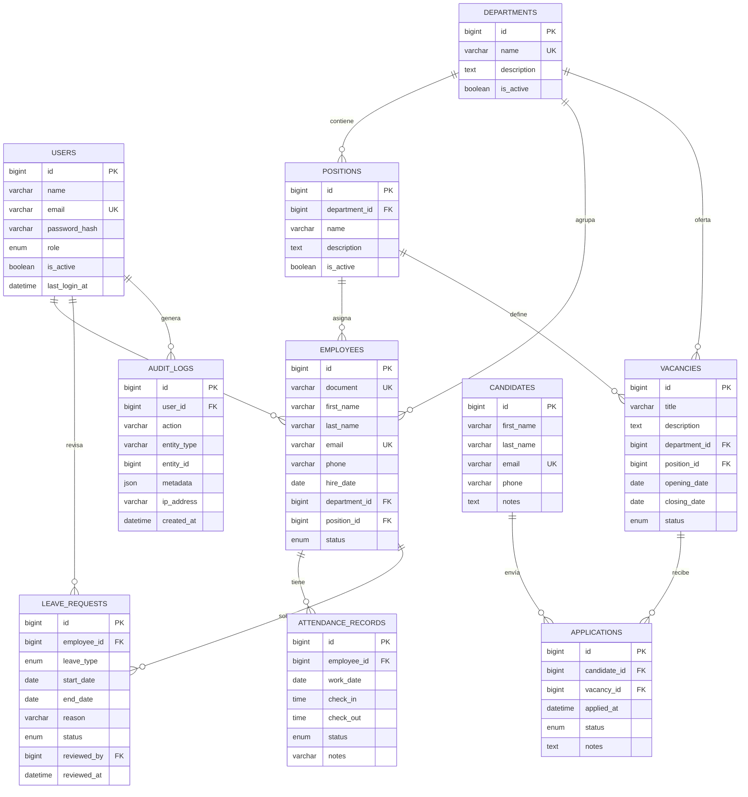

# Modelo de datos

## 1. Convenciones

- Motor **InnoDB**, charset `utf8mb4`, collation `utf8mb4_unicode_ci`.
- Claves primarias `BIGINT UNSIGNED AUTO_INCREMENT`.
- Fechas y horas en UTC; la zona horaria de presentación se configura en la aplicación.
- Nombres de tablas y columnas en inglés y `snake_case`.
- Borrado lógico para registros con historial: `is_active` o `status = 'inactive'`.
- Claves foráneas para integridad referencial.
- Restricciones `UNIQUE` y `CHECK` para las reglas que se pueden garantizar en la base.
- El SQL completo está en [`database/schema.sql`](../database/schema.sql).

## 2. Diagrama entidad-relación



## 3. Tablas

### 3.1 `users`

Cuentas de acceso al sistema. No se crea una cuenta por empleado en el MVP.

| Campo | Tipo | Reglas |
| ----- | ---- | ------ |
| `id` | BIGINT UNSIGNED | PK |
| `name` | VARCHAR(120) | Obligatorio |
| `email` | VARCHAR(190) | Obligatorio, único, minúsculas |
| `password_hash` | VARCHAR(255) | Obligatorio; nunca texto plano |
| `role` | ENUM(`admin`, `hr`) | Obligatorio |
| `is_active` | TINYINT(1) | Por defecto 1 |
| `last_login_at` | DATETIME | Nulo hasta el primer login |
| `created_at`, `updated_at` | TIMESTAMP | Auditoría |

Reglas:

- El último administrador activo no puede desactivarse ni cambiar a `hr`.
- Un usuario no puede eliminarse si tiene registros asociados; se desactiva.
- El correo se normaliza a minúsculas antes de guardar.

### 3.2 `departments`

| Campo | Tipo | Reglas |
| ----- | ---- | ------ |
| `id` | BIGINT UNSIGNED | PK |
| `name` | VARCHAR(100) | Obligatorio, único |
| `description` | TEXT | Opcional |
| `is_active` | TINYINT(1) | Por defecto 1 |

No se elimina un departamento con empleados o cargos asociados; se desactiva.

### 3.3 `positions`

| Campo | Tipo | Reglas |
| ----- | ---- | ------ |
| `id` | BIGINT UNSIGNED | PK |
| `department_id` | BIGINT UNSIGNED | FK a `departments`, obligatorio |
| `name` | VARCHAR(120) | Obligatorio |
| `description` | TEXT | Opcional |
| `is_active` | TINYINT(1) | Por defecto 1 |

- Único por `(department_id, name)`.
- Un cargo pertenece a un solo departamento.
- El servicio de empleados valida que el cargo corresponda al departamento elegido.

### 3.4 `employees`

| Campo | Tipo | Reglas |
| ----- | ---- | ------ |
| `id` | BIGINT UNSIGNED | PK |
| `document` | VARCHAR(30) | Obligatorio, único |
| `first_name` | VARCHAR(80) | Obligatorio |
| `last_name` | VARCHAR(80) | Obligatorio |
| `email` | VARCHAR(190) | Opcional, único |
| `phone` | VARCHAR(30) | Opcional |
| `hire_date` | DATE | Obligatorio |
| `department_id` | BIGINT UNSIGNED | FK obligatoria |
| `position_id` | BIGINT UNSIGNED | FK opcional; si existe, debe pertenecer al departamento |
| `status` | ENUM(`active`, `inactive`) | Por defecto `active` |
| `created_by`, `updated_by` | BIGINT UNSIGNED | FK a `users`, nullable |
| `created_at`, `updated_at` | TIMESTAMP | Auditoría |

Reglas:

- El documento es único.
- Un empleado inactivo conserva su historial, pero no recibe nuevas operaciones de
  asistencia o permisos.
- No se elimina físicamente si tiene historial.
- La reactivación vuelve a `active`.

### 3.5 `attendance_records`

| Campo | Tipo | Reglas |
| ----- | ---- | ------ |
| `id` | BIGINT UNSIGNED | PK |
| `employee_id` | BIGINT UNSIGNED | FK obligatoria |
| `work_date` | DATE | Obligatorio; único junto con `employee_id` |
| `check_in` | TIME | Opcional |
| `check_out` | TIME | Opcional; no anterior a `check_in` |
| `status` | ENUM(`present`, `late`, `absent`) | Obligatorio |
| `notes` | VARCHAR(500) | Opcional |
| `created_by`, `updated_by` | BIGINT UNSIGNED | FK a `users` |
| `created_at`, `updated_at` | TIMESTAMP | Auditoría |

Reglas:

- Un solo registro por empleado y fecha en el MVP.
- La salida no puede ser anterior a la entrada.
- Las tardanzas y ausencias se registran manualmente.
- El historial se conserva; las correcciones quedan registradas.

### 3.6 `leave_requests`

| Campo | Tipo | Reglas |
| ----- | ---- | ------ |
| `id` | BIGINT UNSIGNED | PK |
| `employee_id` | BIGINT UNSIGNED | FK obligatoria |
| `leave_type` | ENUM(`vacation`, `personal`, `sick`, `other`) | Obligatorio |
| `start_date` | DATE | Obligatorio |
| `end_date` | DATE | Obligatorio, mayor o igual a `start_date` |
| `reason` | VARCHAR(500) | Obligatorio |
| `status` | ENUM(`pending`, `approved`, `rejected`) | Por defecto `pending` |
| `reviewed_by` | BIGINT UNSIGNED | FK a `users`, nulo si está pendiente |
| `reviewed_at` | DATETIME | Nulo si está pendiente |
| `review_notes` | VARCHAR(500) | Opcional |
| `created_by` | BIGINT UNSIGNED | FK a `users` |
| `created_at`, `updated_at` | TIMESTAMP | Auditoría |

Transiciones permitidas:

```text
pending ──► approved
pending ──► rejected
```

Una solicitud resuelta no se modifica silenciosamente en el MVP. Cualquier corrección
requiere una regla explícita de reapertura o una nueva solicitud.

La coherencia entre `status`, `reviewed_by` y `reviewed_at` se valida en el servicio:
MariaDB no permite usar en un `CHECK` una columna que participa en una clave foránea
con `ON UPDATE CASCADE`. La regla sigue siendo obligatoria en la aplicación.

### 3.7 `vacancies`

| Campo | Tipo | Reglas |
| ----- | ---- | ------ |
| `id` | BIGINT UNSIGNED | PK |
| `title` | VARCHAR(150) | Obligatorio |
| `description` | TEXT | Opcional |
| `department_id` | BIGINT UNSIGNED | FK obligatoria |
| `position_id` | BIGINT UNSIGNED | FK opcional; debe pertenecer al departamento |
| `opening_date` | DATE | Obligatorio |
| `closing_date` | DATE | Nulo mientras está abierta; al cerrar, fecha de cierre |
| `status` | ENUM(`open`, `closed`) | Por defecto `open` |
| `created_by`, `updated_by` | BIGINT UNSIGNED | FK a `users` |
| `created_at`, `updated_at` | TIMESTAMP | Auditoría |

Reglas:

- Una vacante cerrada no acepta postulaciones.
- El cierre registra la fecha y el usuario.
- No se reabre en el MVP; se crea una nueva vacante si es necesario.

### 3.8 `candidates`

| Campo | Tipo | Reglas |
| ----- | ---- | ------ |
| `id` | BIGINT UNSIGNED | PK |
| `first_name` | VARCHAR(80) | Obligatorio |
| `last_name` | VARCHAR(80) | Obligatorio |
| `email` | VARCHAR(190) | Obligatorio, único |
| `phone` | VARCHAR(30) | Opcional |
| `notes` | TEXT | Opcional |
| `created_by`, `updated_by` | BIGINT UNSIGNED | FK a `users` |
| `created_at`, `updated_at` | TIMESTAMP | Auditoría |

No se almacenan currículos ni documentos en el MVP.

### 3.9 `applications`

| Campo | Tipo | Reglas |
| ----- | ---- | ------ |
| `id` | BIGINT UNSIGNED | PK |
| `candidate_id` | BIGINT UNSIGNED | FK obligatoria |
| `vacancy_id` | BIGINT UNSIGNED | FK obligatoria |
| `applied_at` | DATETIME | Por defecto ahora |
| `status` | ENUM(`received`, `screening`, `interview`, `selected`, `rejected`) | Por defecto `received` |
| `notes` | TEXT | Opcional |
| `created_by`, `updated_by` | BIGINT UNSIGNED | FK a `users` |
| `created_at`, `updated_at` | TIMESTAMP | Auditoría |

Reglas:

- Único por `(candidate_id, vacancy_id)`.
- Solo se crea si la vacante está abierta.
- Transiciones permitidas:

```text
received  → screening | rejected
screening → interview | rejected
interview → selected  | rejected
selected  → (final)
rejected  → (final)
```

- Marcar `selected` no crea un empleado. RR. HH. confirma los datos y usa el alta
  guiada.

### 3.10 `audit_logs`

| Campo | Tipo | Reglas |
| ----- | ---- | ------ |
| `id` | BIGINT UNSIGNED | PK |
| `user_id` | BIGINT UNSIGNED | FK a `users`, nullable |
| `action` | VARCHAR(80) | Obligatorio |
| `entity_type` | VARCHAR(80) | Obligatorio |
| `entity_id` | BIGINT UNSIGNED | Opcional |
| `metadata` | JSON | Opcional, sin PII innecesaria |
| `ip_address` | VARCHAR(45) | Opcional |
| `created_at` | TIMESTAMP | Por defecto ahora |

La aplicación solo inserta; la consulta se restringe a administradores.

## 4. Borrado y desactivación

| Entidad | Estrategia |
| ------- | ---------- |
| `users` | Desactivar (`is_active = 0`); no borrar si tiene historial |
| `departments` | Desactivar (`is_active = 0`) si tiene empleados o cargos |
| `positions` | Desactivar (`is_active = 0`) si tiene empleados o vacantes |
| `employees` | Desactivar (`status = 'inactive'`); conservar historial |
| `attendance_records` | No borrar; corregir con auditoría |
| `leave_requests` | No borrar; conservar estados |
| `vacancies` | Cerrar (`status = 'closed'`); no borrar |
| `candidates` | No borrar si tiene postulaciones |
| `applications` | No borrar; conservar estado final |

## 5. Índices y rendimiento

Índices previstos:

- `users(email)` único.
- `departments(name)` único.
- `positions(department_id, name)` único.
- `employees(document)` único; `employees(email)` único.
- `employees(department_id)`, `employees(position_id)`, `employees(status)`.
- `employees(last_name, first_name)` para búsquedas.
- `attendance_records(employee_id, work_date)` único.
- `attendance_records(work_date)`, `attendance_records(status)`.
- `leave_requests(employee_id)`, `leave_requests(status)`, `leave_requests(start_date, end_date)`.
- `vacancies(status)`, `vacancies(department_id)`.
- `applications(candidate_id, vacancy_id)` único.
- `applications(vacancy_id)`, `applications(status)`.
- `audit_logs(created_at)`, `audit_logs(entity_type, entity_id)`.

Las consultas de listado deben paginarse y evitar N+1.

## 6. Datos demo

`database/seed.sql` contiene:

- 2 usuarios: `admin@gestion-rrhh.test` y `rrhh@gestion-rrhh.test`.
- 5 departamentos y 7 cargos.
- 10 empleados ficticios.
- Registros de asistencia del mes de octubre de 2026.
- Solicitudes de permiso en los tres estados.
- 3 vacantes y 5 candidatos.
- Postulaciones en distintos estados.
- Algunos registros de auditoría.

La contraseña demo del seed es `password123` y debe cambiarse en cualquier entorno que no
sea local. El seed es destructivo y solo se ejecuta en desarrollo.

## 7. Migraciones

- El esquema inicial es `database/schema.sql`.
- Los cambios posteriores se guardan en `database/migrations/` con nombre
  `YYYYMMDDHHMM_descripcion.sql`.
- Una migración aplicada no se edita.
- Cada migración debe probarse en una base limpia y documentar su rollback.
- Las migraciones de producción se ejecutan manualmente desde phpMyAdmin.
